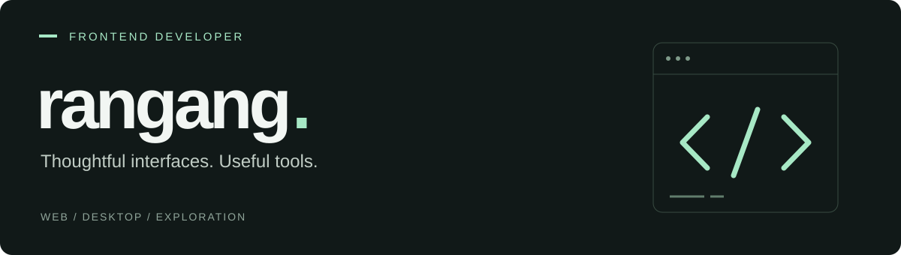

<picture>
  <source media="(prefers-color-scheme: dark)" srcset="./assets/profile-header-dark.svg" />
  <source media="(prefers-color-scheme: light)" srcset="./assets/profile-header-light.svg" />
  
</picture>

# 你好，我是阿刚。

**前端开发者 · 用代码把想法做成好用的工具。**

这里记录我的前端实践、桌面工具与技术探索。从页面交互到文件处理，我喜欢把具体问题拆开，再做成可以使用的小作品。

[浏览我的项目 ↗](https://github.com/rangang?tab=repositories) &nbsp; / &nbsp; [技术笔记 ↗](https://github.com/rangang/rangang-blog)

 

## 技术与实践

**Web** &nbsp; TypeScript · JavaScript · Vue · React · HTML · CSS  
**Tools** &nbsp; Electron · Vite · Git  
**Exploration** &nbsp; Java · Python · Objective-C

 

## 精选项目

### [01 &nbsp; 截图翻译 ↗](https://github.com/rangang/screenshot-translator)

框选屏幕、识别文字，再将翻译覆盖到原图上。支持 Windows 与 macOS，让截图、翻译和保存衔接起来。

`Electron` `JavaScript` `OCR` `Canvas`

### [02 &nbsp; PDF 脱敏处理工具 ↗](https://github.com/rangang/PDF-DataMaskingTool)

在 PDF 上框选需要处理的区域，支持多页浏览、缩放与文件导出，把常用的文档处理操作放进一个界面。

`React` `Vite` `Tailwind CSS` `pdf-lib`

### [03 &nbsp; 教育课程管理系统 ↗](https://github.com/rangang/edu_course_system)

围绕教育课程管理展开的 Java 单体项目。相关探索还包括 [SSM 后台](https://github.com/rangang/ssm_edu_system)、[分布式架构](https://github.com/rangang/distributed_edu) 与 [Spring Boot](https://github.com/rangang/springboot_edu)。

`Java` `课程管理` `后端实践`

 

## 持续积累

每一次提交，都是把想法向前推进一点。

<picture>
  
</picture>

保持好奇，持续动手。 / Stay curious. Keep building.
