<picture>
  <source media="(max-width: 640px)" srcset="./assets/profile-hero-mobile.svg" />
  
</picture>

# 阿刚 / AI 全栈开发者

**让 AI 走出对话框，成为真正可用的产品。**

从界面交互到后端服务，从模型能力到应用落地。我关注 AI 与全栈工程的结合，也持续构建网页应用、桌面工具与解决具体问题的小作品。

[我的项目 ↗](https://github.com/rangang?tab=repositories) &nbsp; · &nbsp; [技术笔记 ↗](https://github.com/rangang/rangang-blog) &nbsp; · &nbsp; [技术雷达](#技术雷达)

 

## 智能应用 → 全栈工程 → 产品体验

<picture>
  <source media="(max-width: 640px)" srcset="./assets/profile-system-mobile.svg" />
  
</picture>

把想法拆成可实现的系统，再把系统打磨成好用的体验。

## 技术雷达

**智能应用方向** &nbsp; 大模型应用 · 提示词设计 · 智能工具与工作流 · AI 辅助研发

**编程语言** &nbsp; TypeScript · JavaScript · Java · Python · Dart · Objective-C

**前端开发** &nbsp; Vue · React · HTML · CSS · 响应式布局

**界面与交互** &nbsp; Tailwind CSS · shadcn/ui · Radix UI · Motion · Lucide

**后端服务** &nbsp; Spring Boot · Spring MVC · MyBatis · 接口开发

**数据与缓存** &nbsp; MySQL · Redis · 数据持久化 · 连接池

**分布式实践** &nbsp; Spring Cloud · Dubbo · ZooKeeper · 服务拆分与协作

**移动与桌面** &nbsp; Flutter · Electron · 跨平台界面 · 桌面应用打包

**文档与图形** &nbsp; PDF.js · pdf-lib · Canvas · 文字识别 · 图像合成

**工程与交付** &nbsp; Vite · Maven · Git · GitHub Actions · electron-builder

 

## 精选作品

<a href="https://github.com/rangang/screenshot-translator">
  <picture>
    <source media="(max-width: 640px)" srcset="./assets/project-translator-mobile.svg" />
    
  </picture>
</a>

**截图翻译** — 框选屏幕、OCR 识别、翻译覆盖与图片导出。支持 Windows 与 macOS，把一串操作收敛到一次选区。

<a href="https://github.com/rangang/PDF-DataMaskingTool">
  <picture>
    <source media="(max-width: 640px)" srcset="./assets/project-pdf-mobile.svg" />
    
  </picture>
</a>

**PDF 脱敏处理工具** — 可视化框选处理区域，支持多页浏览、缩放与 PDF 导出，让文档处理更直接。

<a href="https://github.com/rangang/edu_course_system">
  <picture>
    <source media="(max-width: 640px)" srcset="./assets/project-education-mobile.svg" />
    
  </picture>
</a>

**教育课程管理系统** — Java 单体项目与课程管理实践。继续探索：[SSM 后台](https://github.com/rangang/ssm_edu_system) / [分布式架构](https://github.com/rangang/distributed_edu) / [Spring Boot](https://github.com/rangang/springboot_edu)。

 

## 持续构建

每一次提交，都是把想法向前推进一点。

<picture>
  
</picture>

以智能驱动创造，用工程交付价值。 保持好奇，让想法落地。

