<picture>
  <source media="(max-width: 640px)" srcset="./assets/banner-mobile.svg" />
  
</picture>

<h3 align="center">前端阿刚 · AI 全栈开发者 · 重庆</h3>

  <b>让 AI 走出对话框，成为真正可用的产品。</b> 
  从界面交互到后端服务，从模型能力到应用落地 —— 保持好奇，让想法落地。

  

  GitHub 主页无法运行 WebGL，完整的 3D 交互体验在上方入口 —— 
  一片由代码驱动的粒子星域：拖动旋转、滚轮缩放、重塑参数、触发脉冲、导出快照。

 

## 关于我

写代码，也写产品。关注 **AI 应用 × 全栈工程 × 交互体验** 的交叉地带：把大模型能力装进真实可用的界面，把复杂的系统收敛成一次顺手的操作。桌面工具、网页应用、解决具体问题的小作品，都在持续构建中。

## 技术雷达

**智能应用** &nbsp; 大模型应用 · 提示词设计 · 智能工具与工作流 · AI 辅助研发

**语言** &nbsp; TypeScript · JavaScript · Java · Python · Dart · Objective-C

**前端与交互** &nbsp; Vue · React · Three.js / WebGL · Tailwind CSS · shadcn/ui · Motion

**后端与数据** &nbsp; Spring Boot · Spring Cloud · MyBatis · MySQL · Redis · Dubbo

**移动与桌面** &nbsp; Flutter · Electron · 跨平台界面 · 桌面应用打包

**工程与交付** &nbsp; Vite · Maven · Git · GitHub Actions · electron-builder

 

## 找到我

  <a href="https://rangang.github.io/rangang/"><b>3D 代码星域</b></a> &nbsp;·&nbsp;
  <a href="https://github.com/rangang?tab=repositories">GitHub 仓库</a> &nbsp;·&nbsp;
  <a href="https://github.com/rangang/rangang-blog">技术笔记</a>

以智能驱动创造，用工程交付价值。 每一次提交，都是把想法向前推进一点。
