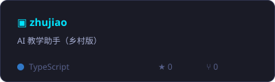
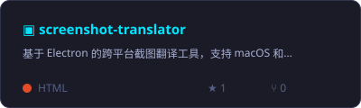
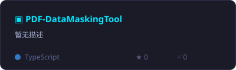
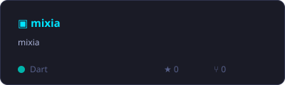
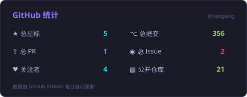
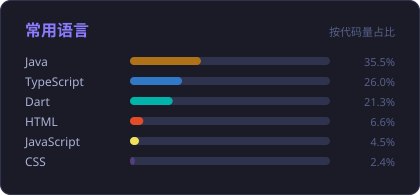

<picture>
  <source media="(max-width: 640px)" srcset="./assets/banner-mobile.svg" />
  
</picture>

  

  
  
  
  
  

  

  GitHub 主页无法运行 WebGL，完整的 3D 交互体验在上方入口 —— 
  拖动旋转 · 滚轮缩放 · 重塑参数 · 触发脉冲 · 导出快照

---

## 🧭 关于我

写代码，也写产品。关注 **AI 应用 × 全栈工程 × 交互体验** 的交叉地带：把大模型能力装进真实可用的界面，把复杂的系统收敛成一次顺手的操作。

- 🌌 **交互体验** — 用 Three.js / WebGL 把数据与想法变成可探索的空间
- 🤖 **AI 落地** — 从提示词设计到工作流编排，让模型能力变成产品功能
- 🛠 **全栈交付** — 界面、服务、数据、部署，一条链路走通

## 🛠 技术雷达

**智能应用**

**语言**

**前端与交互**

**后端与数据**

**移动与桌面**

**工程与交付**

## 🚀 精选项目

  
  

  
  

  📚 <a href="https://github.com/rangang/rangang-blog">技术笔记</a> · 🗂 <a href="https://github.com/rangang?tab=repositories">全部仓库</a>

## 📊 数据星域

  
  

  

  <picture>
    <source media="(prefers-color-scheme: dark)" srcset="https://raw.githubusercontent.com/rangang/rangang/output/snake-dark.svg" />
    
  </picture>

## 🔗 找到我

  <a href="https://rangang.github.io/rangang/"><b>3D 代码星域</b></a> &nbsp;·&nbsp;
  <a href="https://github.com/rangang?tab=repositories">GitHub 仓库</a> &nbsp;·&nbsp;
  <a href="https://github.com/rangang/rangang-blog">技术笔记</a>

